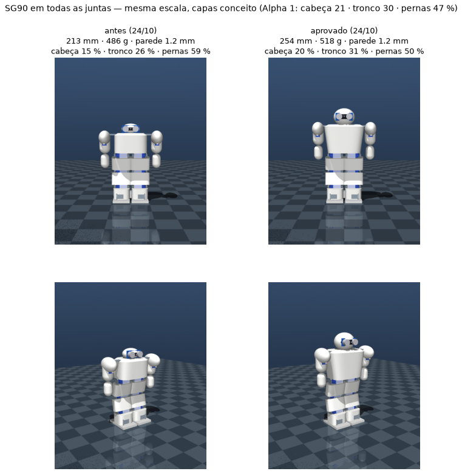

# Arquitetura do corpo inteiro

O robô é **um só projeto**: pernas, tronco, braços e cabeça saem dos mesmos parâmetros
(`sim/tools/body.py`). A simulação, a prévia 3D, a lista de servos e as massas das capas leem esse
mesmo arquivo — mudou uma medida, tudo muda junto. A perna em detalhe continua em
[arquitetura_perna.md](arquitetura_perna.md); os suportes em [suporte_servo.md](suporte_servo.md).

## Segmentos e servos

| Segmento | Juntas (servo) | O que carrega | Capa |
|----------|----------------|---------------|------|
| **Perna** (×2) | quadril pitch, joelho, tornozelo pitch, tornozelo roll | suportes + garfos + 623ZZ, pé 70 × 45 mm | coxa, canela, tornozelo (as juntas ficam à mostra) |
| **Quadril** (pelve) | rotação da cintura (servo em cima dos 2 do quadril pitch) | bateria 2S, reguladores (UBEC 5 V / 7 A + MP1584EN), placa de força, chave, MPU-6050, PCA9685 das pernas e da cintura | bloco 76 × 92 × 52 mm (o menor em que tudo cabe) |
| **Tronco** | — (os 2 servos do ombro pitch ficam nele; gira na cintura ±45°) | ESP32 (PWM direto dos 8 servos dos braços) | escudo: largo nos ombros, mais estreito embaixo; 50 × 78 × 45 mm, V em aberto |
| **Braço** (×2) | ombro pitch (no tronco), ombro roll (dentro do braço), cotovelo (dentro do antebraço), punho que gira (dentro da mão) | mão fixa | ombreira (elipsoide), braço (cápsula), antebraço (largo no servo, fino até o punho), mão |
| **Cabeça** | — (fixa) | HC-SR04 olhando para a frente, 10 g reservados para a câmera (ESP32-CAM) | casca elipsoide com viseira |

**16 servos SG90 (clone), em todas as juntas** — decisão de 24/10 (8 nas pernas, 4 em cada braço). O modelo aceita servo por junta
(`BipedParams.servos`), mas o catálogo tem só o SG90: 9 g, 0,18 N·m de travamento, 0,10 s/60°
(valores a calibrar na bancada F3).

## Capas com massa calculada

Cada capa é uma casca fina que **envolve o esqueleto que está dentro dela** (folga de 1 mm + parede):
a massa vem da área da forma × parede × densidade do PETG (1,27 g/cm³) + 15 % para clipes, pinos
e nervuras. Tronco maior → capa maior → mais massa, automaticamente.

`sim/tools/cover_check.py` confere, peça por peça, o que fica para fora das capas (hoje: só as
juntas, de propósito, e o horn do ombro roll por 2 mm).

**Achado:** com capas cobrindo o robô inteiro, a parede de 1,2 mm dá **142 g de capas** já na
proporção atual — a conta antiga (66 g) estava otimista. O robô na proporção antiga, com capas honestas, tinha
**486 g**, não 410 g.

## Estudo de proporções com SG90 (24/10)

> Feito com o braço de 2 servos (antes do cotovelo e do punho). Os números abaixo são dessa versão;
> o robô atual está na seção do braço, no fim.

`sim/tools/body_variants.py` → `sim/results/body_variants.csv` (ordenado: os que passam primeiro, depois
os mais parecidos com o Alpha). Grade: altura do tronco 45 / 52 / 60 / 68 mm × largura nos ombros
70 / 86 mm × cabeça P / M / G × parede 1,2 / 1,0 / 0,8 mm = 72 variantes. Em cada uma: balanço lateral sem
controle a 0,5 e 1 passo/s na inclinação que **aquela** variante precisa (robô mais alto precisa de
menos inclinação para pôr o peso sobre um pé), apoio numa perna e levantar do agachamento. Passa =
picos ≤ 70 % do SG90 e não tomba. Referência Alpha 1 (medido nas fotos): cabeça 21 · tronco 30 · pernas 47 %.

| Variante | Altura | Cabeça / tronco / pernas | Parede | Massa | Tornozelo roll 0,5 / 1 passo/s | Joelho 0,5 / 1 passo/s | Passa |
|----------|--------|--------------------------|--------|-------|-------------------------------|------------------------|-------|
| antes (tronco 45, ombros 70, cabeça P) | 213 mm | 15 / 26 / 59 % | 1,2 | 486 g | 65 / 69 % | 36 / 70 % | no limite |
| **tronco 68, ombros 86, cabeça G — aprovada** | 254 mm | **20 / 31 / 50 %** | 1,2 | 518 g | 64 / 70 % | 43 / 70 % | no limite |
| tronco 60, ombros 86, cabeça G | 246 mm | 20 / 28 / 51 % | 0,8 | 457 g | 60 / 63 % | 36 / 68 % | no limite |

12 das 72 passam; nenhuma com mais de 2 pontos de folga a 1 passo/s.

O que isso diz:
- **Dá para chegar perto do visual do Alpha com SG90** (20 / 31 / 50 %): tronco de 68 mm, ombros de
  86 mm (os dois ombros pitch ganham o 623ZZ) e cabeça grande (52 × 58 × 48 mm).
- **O limite é o ritmo, não o visual.** O joelho bate ~70 % a 1 passo/s em *todas* as variantes — o
  pico vem do movimento da passada, quase não muda com a massa. A 0,5 passo/s todas sobram
  (joelho ~36–43 %, tornozelo roll ~60–65 %). Com SG90 a passada fica entre 0,5 e ~0,7 passo/s,
  ou a 1 passo/s sem margem.
- Entre variantes vizinhas o balanço sem controle varia ±10 pontos (ex.: a mesma forma passa com
  1,2 mm e não com 1,0 mm) — é ruído do teste, não física. A escolha usa a tendência.
- Parede de 0,8 mm tira ~60 g, mas é frágil em queda (2 perímetros de 0,4 mm).
- O balanço sem controle aceita só ~10–12° de inclinação nas variantes altas: o equilíbrio com IMU
  (F6) é necessário.

**Decisão (24/10, você): tronco 68 mm, ombros 86 mm, cabeça grande (52 × 58 × 48 mm), parede 1,2 mm** —
aplicada em `body.py`. O robô agora tem **254 mm, 518 g (164 g de capas)**, cabeça / tronco / pernas
20 / 31 / 50 %, e os dois ombros pitch com 623ZZ.

Medido no modelo F1 aprovado (tornozelo roll ±12°, a inclinação que ele precisa):

| Teste | Resultado |
|-------|-----------|
| Balanço 0,5 / 0,67 / 1 passo/s | tornozelo roll 64 / 63 / 70 %, joelho 43 / 46 / 70 %; tomba a partir de 1,33 passo/s |
| Uma perna | equilibra entre −14° e −10° (faixa de 4°) |
| Levantar a 1 rad/s | joelho 67 % |
| Agachamento mais fundo | A = 0,70 rad, joelho 37 % |

**Ritmo de trabalho: até ~0,7 passo/s** (folga); 1 passo/s só no limite.

## Braço com cotovelo e punho (24/10)

Pedido: antebraço e punho que se movem, seguindo as marcações das 8 cabeças (cotovelo no umbigo,
punho no púbis, mão de 2/3 a 1 cabeça). Decidido: **punho que gira** (eixo ao longo do antebraço) e
**mão fixa** → 4 servos por braço, 16 no total.

Cadeia, do ombro para a mão — cada servo fica dentro do segmento que ele move:

| Segmento | Comprimento | O que leva dentro | Por que esse tamanho |
|----------|-------------|-------------------|----------------------|
| braço (ombro roll → cotovelo) | 42 mm | servo do ombro roll, corpo para baixo | servo 26 mm + base do garfo do cotovelo 14 mm + 2 mm |
| antebraço (cotovelo → punho) | 36 mm | servo do cotovelo, corpo para baixo; **sem 623ZZ** | suporte do servo 26 mm + placa do punho |
| mão (punho → ponta) | 38 mm | servo do punho, eixo para cima | o servo tem 35 mm do horn ao fundo do suporte; 0,75 cabeça |

Onde as marcações caem no robô:

| Marcação (8 cabeças) | No robô |
|----------------------|---------|
| cotovelo no umbigo | cotovelo 26 mm acima do eixo do quadril (terço de baixo do tronco) ✔ |
| punho no púbis | punho 10 mm abaixo do eixo do quadril, na virilha ✔ |
| mão = 2/3 a 1 cabeça | 38 mm = 0,75 cabeça ✔ |
| ponta dos dedos no meio da coxa | **na altura do joelho** ✘ — a coxa do robô tem só 0,9 cabeça (a humana tem 2) e o servo do punho precisa de 35 mm; é o mínimo da cadeia |

**Largura dos ombros.** O servo do cotovelo fica deitado no eixo da junta e deixa o antebraço com
~49 mm de largura onde está o servo. Ele passa ao lado do tronco, então a largura sai de
*tronco + 2 cotovelos*, não da cabeça. O antebraço afina abaixo do servo (o resto até o punho é fino),
e cada peça do braço guarda 3 mm de tudo o que está ao lado (`body.shoulder_y_mm`).

| Forma das capas | Largura nos ombros | Massa |
|-----------------|-------------------|-------|
| cantos arredondados (`cover_corner_n` = 4) | 19,8 cm | 573 g |
| mais retas (n = 6) | 18,7 cm | 570 g |
| **quase retas (n = 8) — escolhida em 24/10** | **18,2 cm** | **569 g** |

As 2,75 cabeças do Alpha (13,9 cm) não fecham com SG90 no cotovelo.

Simulado com 16 servos e capas quase retas (569 g, tornozelo roll ±12°):

| Teste | Resultado |
|-------|-----------|
| Balanço 0,5 / 0,67 / 1 passo/s | tornozelo roll 68 / 64 / **87 %**, joelho 49 / 46 / 71 % |
| Uma perna | equilibra entre −14° e −10° |
| Levantar | joelho 52 % a 0,5 rad/s, **71 %** a 1 rad/s |

Com as capas mais justas, o garfo do ombro pitch encosta 1,7 mm para fora da capa do tronco, na
junta (fica à mostra como as outras juntas).

**Ritmo com SG90 em tudo: até ~0,67 passo/s; levantar a ≤ 0,7 rad/s.** 1 passo/s reprova no tornozelo roll.

## Quadril, cintura e tronco em V (25/10)

Decisões do dia (você):
- **Rotação da cintura:** o tronco gira ±45° sobre o quadril. É o 17º SG90, preso no quadril em cima dos dois do quadril pitch.
- **Divisão da eletrônica:** no quadril, bateria (com gaveta pela traseira), reguladores, MPU e o PCA9685 das pernas. No tronco, o ESP32, que gera o PWM dos braços. Pela cintura passam só 7 fios ([esquema_eletrico.md](esquema_eletrico.md)).
- **Capas de 0,8 mm.**
- **Tronco em V (variante B).**

| | Antes (manhã) | Agora |
|---|---|---|
| Servos | 16 | 17 |
| Massa / altura | 620 g / 254 mm | **615 g / 288 mm** |
| Tronco | 76 × 78 × 68 mm, ombros 86 | 50 × 62 × 50 mm, ombros 96 (V 1,52) |
| Quadril | dentro do tronco | 76 × 92 × 52 mm (o menor em que tudo cabe) |
| Numa perna / levantar 1 rad/s (joelho) | — / 72 % | 66 % / 79 % |

As variantes do V e os números estão em [plano_correcoes_tronco.md](plano_correcoes_tronco.md) (0.2) e em [simulacao.md](simulacao.md).

