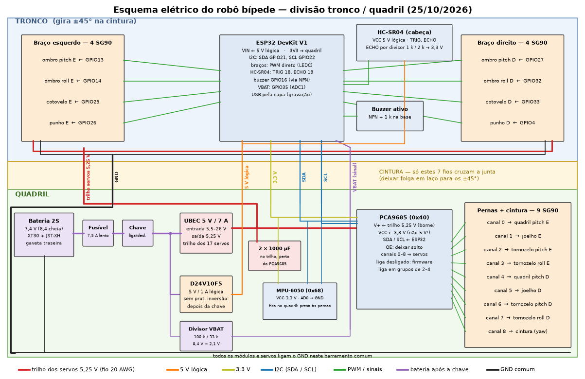

# Esquema elétrico

Rascunho de 25/10/2026, para revisar **juntos** (item do backlog §5). A figura é gerada por
`tools/wiring_diagram.py`, a partir do mesmo mapa de pinos das tabelas abaixo: mudou um pino, mude no
script, rode de novo e atualize a tabela.

```bash
.venv/bin/python tools/wiring_diagram.py   # -> docs/img/esquema_eletrico.{svg,png}
```



## Caminho da energia (quadril)

| Trecho | Ligação | Observação |
|---|---|---|
| Bateria 2S → fusível → chave | XT30, fio 18–20 AWG | fusível de 7,5 A, ação retardada |
| Chave → UBEC 5 V / 7 A → trilho dos servos | 5,25 V, fio 20 AWG | 2 × 1000 µF no trilho, perto do PCA9685 |
| Chave → D24V10F5 → 5 V lógica | ESP32 (VIN) e HC-SR04 | o D24V10F5 não tem proteção contra inversão: fica depois da chave |
| Chave → divisor 100 k / 33 k → VBAT | 8,4 V → 2,08 V no ADC | ADC1 (GPIO35), atenuação de 11 dB |
| ESP32 3V3 → PCA9685 VCC e MPU VCC | 3,3 V | os pull-ups de I2C das placas ficam em 3,3 V; os pinos do ESP32 não toleram 5 V |

## Fios que cruzam a cintura (7)

| Fio | De → para | Bitola |
|---|---|---|
| Trilho dos servos 5,25 V | UBEC (quadril) → 8 servos dos braços (tronco) | 20 AWG |
| GND | barramento comum | 20 AWG |
| 5 V lógica | D24V10F5 → ESP32 VIN, HC-SR04 | fino |
| 3,3 V | ESP32 → PCA9685 VCC, MPU | fino |
| SDA, SCL | ESP32 ↔ PCA9685, MPU | fino, trançados |
| VBAT (sinal) | divisor → GPIO35 | fino |

Os cabos dos servos não cruzam a cintura. Deixe folga em laço para o giro de ±45°.

## ESP32 (tronco)

| GPIO | Ligação | GPIO | Ligação |
|---|---|---|---|
| 13 | ombro pitch E | 27 | ombro pitch D |
| 14 | ombro roll E | 32 | ombro roll D |
| 25 | cotovelo E | 33 | cotovelo D |
| 26 | punho E | 4 | punho D |
| 21 | SDA | 22 | SCL |
| 18 | HC-SR04 TRIG | 19 | HC-SR04 ECHO (divisor 1 k / 2 k) |
| 16 | buzzer (NPN + 1 k na base) | 35 | VBAT (ADC1) |

Os pinos de boot (0, 2, 5, 12, 15), os da flash (6–11) e os só de entrada (34–39, exceto o ADC) ficaram livres.

## PCA9685 (quadril, 0x40) → pernas e cintura

| Canal | Servo | Canal | Servo |
|---|---|---|---|
| 0 | quadril pitch E | 4 | quadril pitch D |
| 1 | joelho E | 5 | joelho D |
| 2 | tornozelo pitch E | 6 | tornozelo pitch D |
| 3 | tornozelo roll E | 7 | tornozelo roll D |
| 8 | cintura (yaw) | 9–15 | livres |

- **V+ (borne):** trilho de 5,25 V. **VCC:** 3,3 V. **OE:** solto (a placa já o mantém habilitado).
- **Ligar sem pulso:** o PCA9685 liga com todas as saídas desligadas, e o LEDC do ESP32 só gera pulso
  quando o firmware configura. Por isso nenhum servo se mexe no boot. O firmware manda a primeira
  posição em grupos de 2 a 4 servos ([alimentacao.md](alimentacao.md)).
- **MPU-6050 (0x68):** no mesmo barramento I2C, com AD0 no GND.
