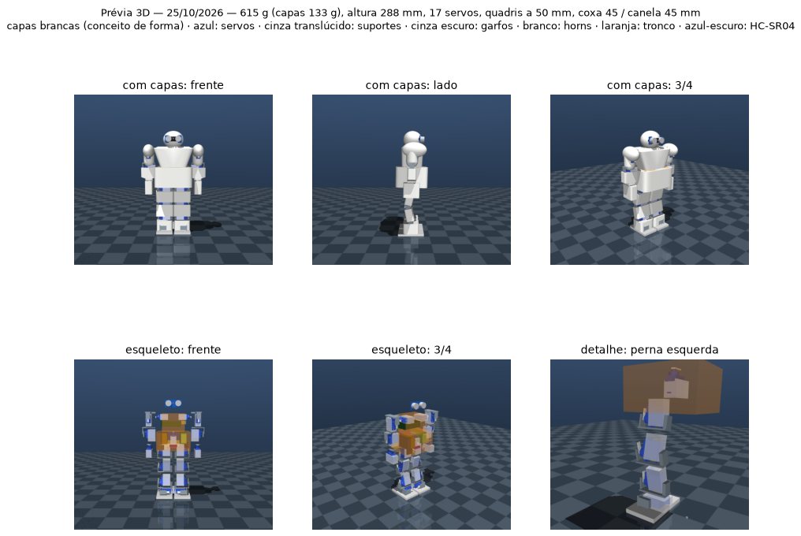

# Prévia 3D do robô

Uma **prévia**, não o modelo final: mostra como o robô fica com as medidas e as decisões
**atuais** do projeto, e é atualizada a cada evolução.



## O que ela mostra

| Cor | Peça | De onde vem |
|-----|------|-------------|
| azul | **servos SG90** | a malha do modelo de referência (`cad/parts/servo_sg90.py`, suas medidas) |
| cinza translúcido | **suportes** (seguram o corpo do servo) | o conceito em [suporte_servo.md](suporte_servo.md) — ainda caixas, não a peça desenhada |
| cinza escuro | **garfos** (braço no horn + braço com o rolamento) | idem |
| branco | **horns** | caixa provisória — falta medir o horn |
| prata | **rolamentos 623ZZ** | a malha do modelo de referência (`cad/parts/bearing_623zz.py`) |
| branco (linha de cima) | **capas conceito**: escudo do tronco, cabeça com viseira, ombreiras, braços, coxas, canelas, tornozelos — cada uma envolve o esqueleto dela | `sim/tools/body.py` (forma e massa) |
| laranja translúcido | **tronco** (esqueleto), com a LiPo (atrás), o ESP32 (na frente), o MPU-6050 (no fundo) e os 2 servos do ombro pitch dentro | `BipedParams` |
| azul-escuro | **HC-SR04** na cabeça (os dois "olhos" prateados), 10 g reservados para a câmera | `BipedParams` |
| cinza escuro (braços) | ombro roll **dentro do braço**, garfo pendurado no elo do ombro, antebraço | conceito provisório — ombro ainda não desenhado |
| branco (embaixo) | **pés** | `BipedParams` |

Tudo é calculado das mesmas medidas da simulação (`sim/tools/build_biped.py`). O eixo de cada servo
coincide com o eixo da sua junta e o garfo tem 0,5 mm de folga do suporte (conferido por número,
não só na imagem).

**Ainda não aparecem:** as capas, os parafusos, os cabos, o formato real do horn e das peças
desenhadas, os batentes, os encaixes das capas e a câmera (só a massa dela está contada).

**Ombro provisório:** o servo do ombro pitch fica dentro do tronco, com o horn logo fora da parede, e
**não tem rolamento** do outro lado — as duas pilhas horn + servo + rolamento (42 mm cada) não cabem
lado a lado nos 70 mm do tronco, e o braço pesa só ~32 g. Um elo leva até o ombro roll, que usa
suporte + garfo como as juntas da perna.

## Ver e mexer em 3D

```bash
.venv/bin/python sim/tools/monitor.py --model preview
```

É o mesmo monitor do [tutorial do MuJoCo](tutorial_mujoco.md): gire com o mouse, use as teclas
**1–4** e **+ / −** para agachar.

## Atualizar

```bash
make preview
```

Refaz as malhas a partir dos scripts de CAD, o modelo e as imagens. Rodar sempre que mudar uma
medida, uma peça ou o conceito do suporte — e registrar a mudança no histórico abaixo.

## Histórico

| Data | O que mudou |
|------|-------------|
| 24/10/2026 | Primeira prévia: 359 g, quadris a 50 mm, coxa e canela de 45 mm, tornozelo pitch→roll de 22 mm, pé 70 × 45 mm; suportes e garfos do conceito aprovado em caixas |
| 24/10/2026 | Cabeça com HC-SR04 (+ 10 g de reserva para câmera) e braços com 2 servos cada (ombro pitch + roll) → 12 servos; bateria 2× 18650 (95 g) trocada por LiPo 2S de 55 g; total 410 g |
| 24/10/2026 | Capas conceito brancas cobrindo o corpo inteiro, com massa calculada pela forma (142 g → total 486 g); ombro roll dentro do braço, ombreira e braços em cápsula; imagem com e sem capas. Comparação de proporções em [arquitetura_corpo.md](arquitetura_corpo.md) |
| 24/10/2026 | Proporção estilo Alpha 1, SG90 em tudo: tronco 68 mm, ombros 86 mm (ombro pitch com 623ZZ), cabeça 52 × 58 × 48 mm, parede 1,2 mm → 254 mm, 518 g (capas 164 g), cabeça / tronco / pernas 20 / 31 / 50 % |
| 24/10/2026 | Braços com cotovelo (servo no antebraço) e punho que gira (servo na mão), mão fixa → 16 servos; marcações das 8 cabeças; 573 g (capas 179 g), ombros 19,8 cm |
| 24/10/2026 | Capas quase retas (seção com canto pouco arredondado): ombros 18,2 cm, 569 g (capas 175 g) |
| 25/10/2026 | Quadril separado do tronco com a cintura girando ±45° (17º SG90 no quadril); eletrônica no quadril (gaveta da bateria atrás), ESP32 no tronco; capas de 0,8 mm; tronco em V (50 × 62 × 50 mm, ombros 96, peito/cintura 1,52); quadril 76 × 92 × 52 mm → 288 mm, 615 g (capas 133 g) |
